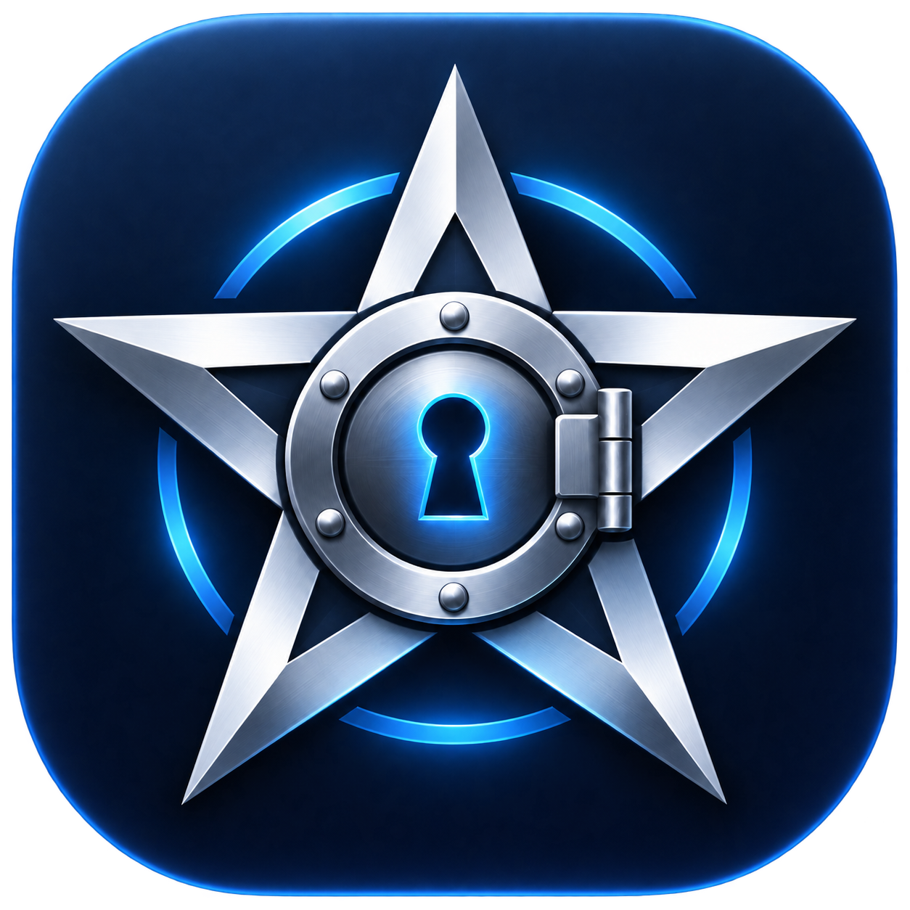

# StarCrypt



StarCrypt is a fast, lightweight command-line tool for creating and extracting Cryptomator-compatible encrypted vaults. Encrypt entire directories without Java, FUSE, WebDAV, volume mounting, or background services.

Designed for simplicity and automation, StarCrypt uses multithreaded processing with low memory overhead while preserving original files and timestamps.

## Features

- **Cryptomator compatible** — Create standard vaults that work with the official Cryptomator application.
- **No mounting required** — Encrypt and decrypt entire directories directly from the command line.
- **Non-destructive** — Original files are never modified, and their timestamps are preserved.
- **Fast and efficient** — Multithreaded encryption and decryption with minimal memory usage.
- **Archive support** — Create and extract encrypted vaults packaged as ZIP or 7z archives.
- **Automation-friendly** — No Java runtime, desktop application, or background services.

## Build

Requires Rust 1.95+ and Xcode Command Line Tools on macOS.

```sh
cargo build --release --locked
cargo test --locked
```

The executable is located at `target/release/starcrypt`. To install it on your PATH:

```sh
cargo install --path . --locked
```

## Usage

### Create a Vault

```sh
# Standard Cryptomator vault
starcrypt create ~/Documents/photos ~/Backups/photos-vault

# ZIP archive
starcrypt create ~/Documents/photos ~/Backups/photos-vault.zip --zip

# 7z archive
starcrypt create ~/Documents/photos ~/Backups/photos-vault.7z --7z
```

The `--zip` and `--7z` options package a standard encrypted Cryptomator vault into an archive. **Archives contain encrypted data, never the original plaintext files.**

### Extract a Vault

```sh
# Standard Cryptomator vault
starcrypt extract ~/Backups/photos-vault ~/Desktop/restored-photos

# ZIP archive
starcrypt extract ~/Backups/photos-vault.zip ~/Desktop/restored-photos

# 7z archive
starcrypt extract ~/Backups/photos-vault.7z ~/Desktop/restored-photos
```

StarCrypt automatically locates, validates, and unlocks the vault using its password.

Archives must contain exactly one valid Cryptomator vault. Corrupt archives, multiple vaults, unsafe paths, archive symlinks, and separately password-protected archives are rejected.

### Cryptomator Compatibility

Vaults created by StarCrypt can be opened in the official Cryptomator desktop application.

For ZIP or 7z archives, unpack the archive first, then open the extracted `vault.cryptomator` file in Cryptomator.

## Temporary Storage

Archived vault operations use temporary disk space for encrypted data:

- **Creating:** Requires space for the temporary encrypted vault and final archive.
- **Extracting:** Requires space for the unpack